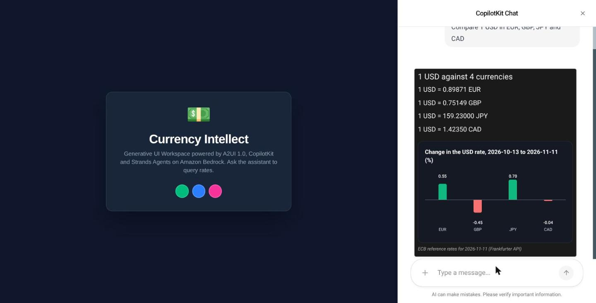

# Currency Agent on AWS: Strands Agents, Amazon Nova and A2UI 1.0

A currency agent that answers with generated UI, run entirely on AWS. It is the AWS sibling of [currency-claude-agui-a2ui1](https://github.com/xbill9/currency-claude-agui-a2ui1), which runs the same app on Google ADK and Gemini.

- **Agent:** [Strands Agents](https://strandsagents.com) on Amazon Bedrock, model `us.amazon.nova-2-lite-v1:0`
- **Hosting:** the agent runs on Amazon Bedrock AgentCore Runtime (AG-UI protocol); the Next.js UI runs on Amazon ECS Express Mode
- **Generative UI:** A2UI 1.0, with the server-side macros `RateCard`, `RateHistoryChart` and `RateComparison`
- **Rates:** the Frankfurter API (ECB reference rates), through a FastMCP server that the agent starts as a stdio child process



## Architecture

```
Browser
  │  CopilotKit (AG-UI)
  ▼
Next.js UI ── ECS Express Mode (task role: bedrock-agentcore:InvokeAgentRuntime)
  │  /api/agentcore signs each run with SigV4
  ▼
Strands agent ── AgentCore Runtime, protocol AGUI, /invocations
  ├─ Amazon Nova 2 Lite on Bedrock (ConverseStream)
  ├─ send_a2ui_json_to_client: compile A2UI Express → validate → expand macros → validate
  └─ MCP (stdio): get_exchange_rate → api.frankfurter.dev
```

| Piece | Path |
|---|---|
| Agent, A2UI tool, prompt | `app/agent/currency_agent/agent.py` |
| Server-side macros and the charts catalog | `app/agent/currency_agent/macros.py`, `custom_catalog.json` |
| A2UI-as-text safety net | `app/agent/currency_agent/a2ui_rescue.py` |
| AG-UI app (AgentCore contract: `/invocations`, `/ping`, port 8080) | `app/agent/main.py` |
| MCP server | `app/agent/mcp_server.py` |
| AgentCore project | `agentcore/agentcore.json` |
| UI, SigV4 proxy to AgentCore | `frontend-react/`, `frontend-react/src/app/api/agentcore/route.ts` |
| UI deploy (ECR, task role, ECS Express Mode) | `infra/deploy_ui.sh` |

## How the A2UI path works on Strands

The model writes A2UI Express, for example `root = RateCard("USD", "EUR", 250)`, and passes it to the `send_a2ui_json_to_client` tool. The tool compiles it with `a2ui-agent-sdk`, validates it against the inference catalogs (Basic 1.0, the charts catalog and the macro sidecar), runs the macros, which fetch the rates on the server, and validates the expanded messages against the catalogs the renderer implements. The result is one A2UI 1.0 `createSurface` message per surface, returned as the tool result under `validated_a2ui_json`. `ag-ui-strands` streams it to the browser as an AG-UI `TOOL_CALL_RESULT`, and `@a2ui/react` renders it.

- **The UI is the answer.** After a successful send the tool calls `agent.cancel(after_current_tools=True)`, so the turn ends without a second model call. A rejected payload goes back to the model, which can fix it or answer in text.
- **A2UI written as reply text still renders.** `RescuingBedrockModel` wraps the Bedrock stream: text from `<a2ui` onward is held out of the chat, and each block becomes a `toolUse` for the UI tool with stop reason `tool_use`.

## Results

Ten prompts, ten runs each, sent through the UI's CopilotKit endpoint by `tools/render_suite.py`. A UI prompt passes when A2UI rendered and no raw `<a2ui` text reached the chat.

| Where | Model | Clean renders |
|---|---|---|
| Local agent and UI | `us.amazon.nova-2-lite-v1:0` | 100 of 100 (`evidence/render-suite-nova-2-lite.txt`) |
| AWS: ECS Express Mode → AgentCore Runtime | `us.amazon.nova-2-lite-v1:0` | 100 of 100 (`evidence/render-suite-aws.txt`) |

## Run locally

Use the active `python3`; no virtualenv. AWS credentials with Bedrock access are required (`aws login`).

```bash
pip install -e app/agent                       # or install the listed dependencies
cd app/agent && PORT=8090 python3 main.py      # agent + MCP (stdio), AG-UI at /invocations
cd frontend-react && npm install --ignore-scripts --legacy-peer-deps
PORT=3001 AGENT_URL=http://127.0.0.1:8090/invocations npx next dev --webpack -p 3001
```

Open http://localhost:3001. Offline tests: `python3 -m pytest tests`.

## Deploy to AWS

Needs the AgentCore CLI (`npm install -g @aws/agentcore`), Docker and AWS credentials.

```bash
./infra/configure_aws_target.sh    # agentcore/aws-targets.json from the active account and region
agentcore deploy                   # agent → AgentCore Runtime (CodeZip, Python 3.14, AGUI)
./infra/deploy_ui.sh               # UI → ECR → ECS Express Mode; prints the HTTPS endpoint
```

Pick another Bedrock model with the `BEDROCK_MODEL_ID` env var in `agentcore/agentcore.json`. Use an inference profile id such as `us.amazon.nova-2-lite-v1:0`.

## Models measured

One run each of four prompts on 2026-11-11 (`tools/model_probe.py`, before the safety net): `us.amazon.nova-2-lite-v1:0` sent UI for 2 of 3 UI prompts and wrote the third as reply text; `us.amazon.nova-pro-v1:0` looped on 19 rejected A2UI payloads for the 90-day chart; `us.amazon.nova-premier-v1:0` is past end of life on Bedrock.

## Credits

The currency agent design comes from [jackwotherspoon/currency-agent](https://github.com/jackwotherspoon/currency-agent).
