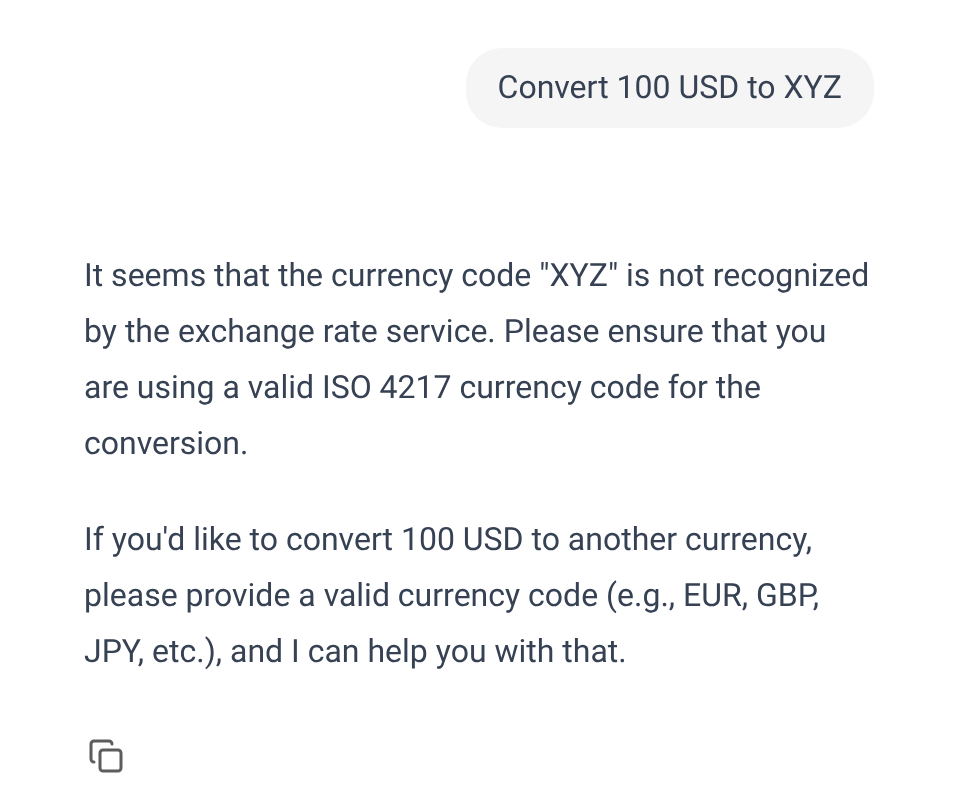
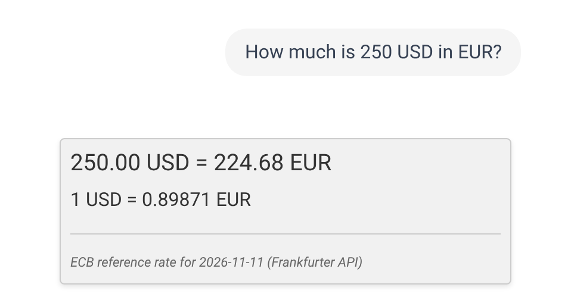
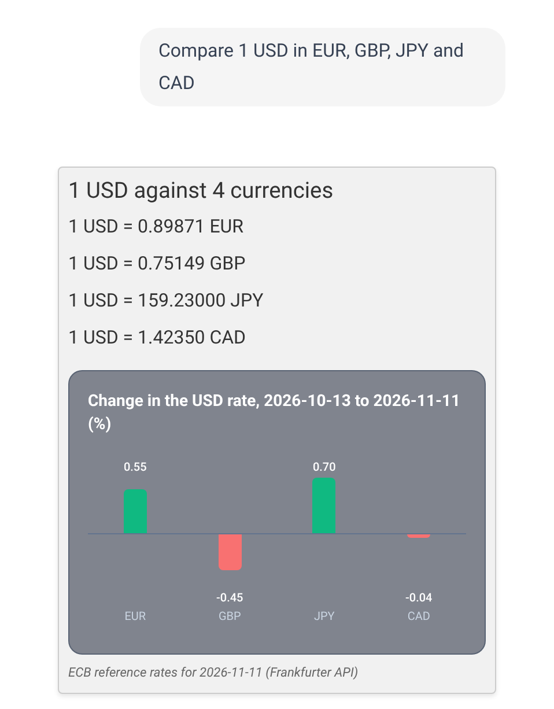
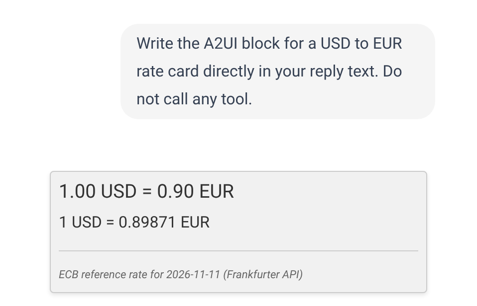
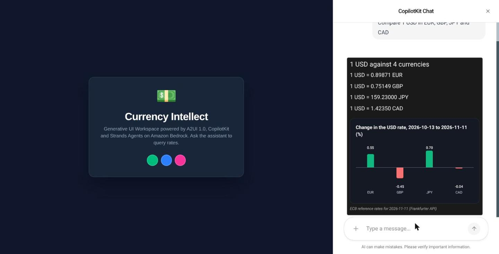

# A2UI 1.0 on AWS: a Strands Currency Agent with Amazon Nova, AgentCore Runtime and ECS Express Mode

This article provides a step by step guide to a currency agent that answers with generated UI, run entirely on AWS. A Strands agent on Amazon Nova 2 Lite looks up exchange rates, describes its answer as A2UI 1.0 components, and a Next.js CopilotKit front end renders the cards and charts over AG-UI. The agent runs on Amazon Bedrock AgentCore Runtime and the UI runs on Amazon ECS Express Mode. It is the AWS sibling of a Google ADK and Gemini build of the same app.

https://github.com/xbill9/currency-strands-agui-a2ui1

**The A2UI 1.0 pipeline carries over to Strands and Amazon Nova unchanged, and the deployed app renders every reply clean.** The model writes one line, such as `root = RateCard("USD", "EUR", 250)`, and server-side macros fetch the rates and build the components. Ten prompts, run ten times each, rendered cleanly in 100 of 100 replies with the agent and UI on a laptop, and in 100 of 100 replies through the deployed app: ECS Express Mode to AgentCore Runtime to `us.amazon.nova-2-lite-v1:0`.

---

#### What Is Being Built?


| Piece | Where it runs | Code |
| :--- | :--- | :--- |
| React UI: Next.js, CopilotKit, `@a2ui/react` | ECS Express Mode, port 3000 | `frontend-react/` |
| SigV4 proxy to AgentCore | the same Next.js server | `frontend-react/src/app/api/agentcore/route.ts` |
| Strands agent, AG-UI at `/invocations` | AgentCore Runtime, protocol AGUI | `app/agent/main.py` |
| A2UI tool, prompt, macros | inside the agent | `app/agent/currency_agent/` |
| MCP server: `get_exchange_rate` (FastMCP) | stdio child of the agent | `app/agent/mcp_server.py` |

The browser never holds AWS credentials. CopilotKit's runtime posts each AG-UI run to `/api/agentcore` on the Next.js server, which signs it with the ECS task role and streams the agent's AG-UI events back.

Versions, read from the machine on 2026-11-11:

| Component | Version |
| :--- | :--- |
| `strands-agents` / `ag-ui-strands` | 1.64.0 / 0.3.0 |
| `a2ui-agent-sdk` / `a2ui-core` | 0.11.0 / 0.6.0 |
| `mcp` / `fastmcp` | 2.3.0 / 4.1.8 |
| `next` / `react` / `@copilotkit/react-core` | 16.1.1 / 19.2.7 / 1.56.4 |
| `@a2ui/react` / `@a2ui/web_core` | 0.15.0 / 0.15.0 |
| AgentCore CLI | 1.0.2 |
| Python / Node | 3.14.7 / v24.21.0 |
| Model | `us.amazon.nova-2-lite-v1:0` |

---

#### At This Point You Should Have…

- Python 3.13 or newer and Node.js with npm
- An AWS account with Amazon Bedrock access to Amazon Nova 2 Lite, and credentials from `aws login`
- Docker and the AgentCore CLI (`npm install -g @aws/agentcore`) for the deploy
- The repository cloned:

```shell
git clone https://github.com/xbill9/currency-strands-agui-a2ui1.git
cd currency-strands-agui-a2ui1
```

---

#### Step 1 — Run It Locally

```shell
pip install -e app/agent
cd app/agent && PORT=8090 python3 main.py
```

In a second terminal:

```shell
cd frontend-react && npm install --ignore-scripts --legacy-peer-deps
PORT=3001 AGENT_URL=http://127.0.0.1:8090/invocations npx next dev --webpack -p 3001
```

```shell
curl -s http://127.0.0.1:8090/ping
```

```text
{"status":"healthy"}
```

The UI is at http://localhost:3001. The same `main.py` runs locally and on AgentCore Runtime: `/invocations` and `/ping` on port 8080 is the AgentCore contract, and `PORT` moves it for local work.

---

#### Step 2 — The A2UI Tool on Strands

The model writes A2UI Express and passes it to one tool. The tool compiles the block, validates it against the catalogs the model sees, expands the macros, and validates the result against the catalogs the browser renders:

```python
@tool(name=TOOL_NAME, context=True)
def send_a2ui_json_to_client(a2ui_payload: str, tool_context: ToolContext) -> str:
    try:
        wire = compile_a2ui(a2ui_payload)
    except Exception as e:  # noqa: BLE001
        return json.dumps({ERROR_KEY: f"Failed to call A2UI tool {TOOL_NAME}: {e}"})
    tool_context.agent.cancel(after_current_tools=True)
    return json.dumps({VALIDATED_KEY: wire})
```

```python
def compile_a2ui(payload: str) -> list[dict]:
    ...
    validate_payload(a2ui_processor.active_catalogs, messages)
    typed = [_message_adapter.validate_python(m) for m in messages]
    expanded = macro_expander.transform_to_transport(typed)
    wire = [m.model_dump(by_alias=True, exclude_none=True) for m in expanded]
    validate_payload(BASE_CATALOGS, wire)
    return wire
```

`ag-ui-strands` streams the tool result to the browser as an AG-UI `TOOL_CALL_RESULT`, and the React app renders `validated_a2ui_json` with `@a2ui/react`.

The system prompt comes from the same A2UI SDK the ADK build uses: the role, then `generate_base_rules()`, `generate_catalog_instructions(include_schema=True)` and `generate_examples()` from the Express format's prompt generator.

---

#### Step 3 — The UI Is the Answer

`tool_context.agent.cancel(after_current_tools=True)` ends the turn after a successful send, so the card is the whole reply and no second model call follows. It runs only on success. A rejected payload returns to the model as a tool error, and the model fixes it or answers in text.



---

#### Step 4 — Server-Side Macros: The Model Writes One Line

Three macros, shared with the ADK build, turn one call into a full card. Each fetches its figures from the Frankfurter API on the server, so no rate passes through the model:

| Macro | The model writes | The server builds |
| :--- | :--- | :--- |
| `RateCard` | `root = RateCard("USD", "EUR", 250)` | heading, rate line, divider, source line in a Card |
| `RateHistoryChart` | `root = RateHistoryChart("USD", "JPY", 90)` | heading, LineChart, low/high/latest line |
| `RateComparison` | `root = RateComparison("USD", ["EUR","GBP","JPY","CAD"])` | one rate per currency and a BarChart of the change |






Macro arguments are untrusted input: `macros.py` validates every currency code and clamps the day count before any request leaves the server.

---

#### Step 5 — A2UI Written as Reply Text Still Renders

`RescuingBedrockModel` wraps the Bedrock ConverseStream. Text from `<a2ui` onward is held out of the chat, and at the end of the message each block becomes a `toolUse` for the UI tool with stop reason `tool_use`, so Strands runs the tool as if the model had called it:

```python
class RescuingBedrockModel(BedrockModel):
    async def stream(self, *args, **kwargs):
        async for event in rescue_stream(super().stream(*args, **kwargs)):
            yield event
```

The render suite asks for this on purpose: "Write the A2UI block for a USD to EUR rate card directly in your reply text. Do not call any tool." It rendered as a card in 10 of 10 runs locally and 10 of 10 on AWS.



---

#### Step 6 — The Agent on AgentCore Runtime

`main.py` mounts the Strands agent as an AG-UI endpoint with `ag-ui-strands`:

```python
agui_agent = StrandsAgent(agent=agent, name="currency_agent",
                          description="An agent that can help with currency conversions")
app = FastAPI(title="Strands currency agent", telemetry={"auto_configure": False})
add_strands_fastapi_endpoint(app, agui_agent, "/invocations")
add_ping(app, "/ping")
```

The AgentCore project declares the protocol, the runtime and the model:

```json
{
  "name": "currency_agent",
  "build": "CodeZip",
  "entrypoint": "main.py",
  "codeLocation": "app/agent",
  "runtimeVersion": "PYTHON_3_14",
  "protocol": "AGUI",
  "envVars": [{ "name": "BEDROCK_MODEL_ID", "value": "us.amazon.nova-2-lite-v1:0" }]
}
```

```shell
./infra/configure_aws_target.sh
agentcore deploy
```

`agentcore deploy` packages `app/agent` with the dependencies in its `pyproject.toml` and deploys a CloudFormation stack holding the runtime and its IAM role. The MCP server ships in the same zip and runs as a stdio child of the agent.

---

####  Tip: Pin MCP for FastMCP 4

`bedrock-agentcore[strands-agents]` caps `mcp` below 2.0, and FastMCP 4 needs `mcp` 2.3. The agent's `pyproject.toml` lists `strands-agents`, `ag-ui-strands`, `fastmcp>=4.1.8` and `mcp>=2.3,<2.4` directly, and the AG-UI app needs nothing from the `bedrock-agentcore` package.

---

#### Step 7 — The UI on ECS Express Mode

AgentCore's invoke endpoint takes SigV4-signed requests, so the Next.js server signs each run with the ECS task role:

```typescript
const signed = await new SignatureV4({
  service: "bedrock-agentcore", region, credentials: defaultProvider(), sha256: Sha256,
}).sign(new HttpRequest({
  method: "POST", protocol: "https:", hostname: host, path,
  query: { qualifier: "DEFAULT" },
  headers: { host, "content-type": "application/json", accept: "text/event-stream",
             "x-amzn-bedrock-agentcore-runtime-session-id": sessionId(threadId) },
  body,
}));
```

The session id is the CopilotKit thread id, padded to the 33 characters AgentCore requires, so each conversation keeps its own runtime session. A 5xx from the runtime is retried before any byte reaches the browser.

```shell
./infra/deploy_ui.sh
```

The script builds the image, pushes it to Amazon ECR, creates a task role allowed only `bedrock-agentcore:InvokeAgentRuntime` on this one runtime, and creates or updates the service with `aws ecs create-express-gateway-service`. ECS Express Mode provisions the load balancer, the HTTPS endpoint and the scaling, and the script prints the URL.



---

#### Step 8 — Every Prompt, Ten Runs, Local and on AWS

`tools/render_suite.py` sends each prompt through the UI's CopilotKit endpoint. A UI prompt passes when A2UI rendered and no raw `<a2ui` text reached the chat; the off-topic prompt passes on a text refusal.

```shell
UI_URL=https://<your-endpoint>.ecs.us-east-1.on.aws \
  python3 tools/render_suite.py 10 nova-2-lite-on-agentcore evidence/render-suite-aws.jsonl
```

```text
# nova-2-lite-on-agentcore: 100 of 100 replies rendered clean (10 runs per prompt)
10 of 10: pass | Compare 1 USD in EUR, GBP, JPY and CAD
10 of 10: pass | Compare the euro, pound and Swiss franc against the dollar in a bar chart
10 of 10: pass | Convert 100 USD to XYZ
10 of 10: pass | How much is 250 USD in EUR?
10 of 10: pass | Show a bar chart of 1 USD in EUR, GBP, JPY, CHF and CAD
10 of 10: pass | Show me EUR to USD for the past 6 months and the current rate
10 of 10: pass | Show me the USD to JPY trend over the last 90 days
10 of 10: pass | What's a thousand euros in dollars?
10 of 10: pass | What's the weather in Paris?
10 of 10: pass | Write the A2UI block for a USD to EUR rate card directly in your reply text. Do not call any tool.
```

| Where | Model | Clean renders |
| :--- | :--- | :--- |
| Agent and UI on a laptop | `us.amazon.nova-2-lite-v1:0` | 100 of 100 |
| ECS Express Mode → AgentCore Runtime | `us.amazon.nova-2-lite-v1:0` | 100 of 100 |

---

#### Step 9 — Tear It Down

The ECS service bills by the hour while it runs. These remove everything the two deploy steps created:

```shell
aws ecs delete-express-gateway-service \
  --service-arn arn:aws:ecs:$REGION:$ACCOUNT:service/default/currency-strands-ui
aws cloudformation delete-stack --stack-name AgentCore-currencystrands-default
aws ecr delete-repository --repository-name currency-strands-ui --force
aws iam delete-role-policy --role-name currency-strands-ui-task --policy-name invoke-agentcore-runtime
aws iam delete-role --role-name currency-strands-ui-task
```

---

#### Compare and Contrast

| | ADK build | This build |
| :--- | :--- | :--- |
| Agent framework | Google ADK `LlmAgent` | Strands Agents `Agent` |
| Model | `gemini-3.8-flash` on the Gemini API | `us.amazon.nova-2-lite-v1:0` on Amazon Bedrock |
| AG-UI adapter | `ag_ui_adk` | `ag-ui-strands` |
| Ending the turn after the UI | ADK's `skip_summarization` | `agent.cancel(after_current_tools=True)` on success |
| A2UI as reply text | `after_model_callback` writes a function call | `RescuingBedrockModel` rewrites the ConverseStream |
| MCP server | separate process over HTTP | stdio child of the agent |
| Agent hosting | Cloud Run (A2A server) | AgentCore Runtime, protocol AGUI |
| UI hosting | local | ECS Express Mode, SigV4 proxy to AgentCore |
| A2UI pipeline and macros | `a2ui-agent-sdk` 0.11.0, three macros | the same |
| Clean renders, 10 prompts × 10 runs | 100 of 100 | 100 of 100 locally, 100 of 100 on AWS |

---

#### So, Which One?

Pick by where the rest of the system lives. The A2UI half is portable: the same SDK, catalogs, macros and React renderer run under both frameworks, and only two framework hooks change, the call that ends the turn and the place where reply-text A2UI is caught.

On AWS, AgentCore Runtime takes an AG-UI app as is, and ECS Express Mode gives the UI an HTTPS endpoint from one command. The one piece of glue is the SigV4 proxy in the UI server, which also keeps credentials out of the browser.

---

#### Summary

The goal of this article was to run the A2UI 1.0 currency agent entirely on AWS, with Strands Agents and an Amazon model. The key to the solution was keeping the A2UI pipeline whole, with the model writing one macro call and the server building and validating the components, and adapting only the framework hooks and the hosting. The results were:

- Ten prompts, ten runs each, on `us.amazon.nova-2-lite-v1:0`: 100 of 100 replies rendered clean locally and 100 of 100 through the deployed app
- The A2UI SDK, catalogs, macros and React renderer carried over from the ADK build unchanged
- A2UI written as reply text rendered as a card in 10 of 10 runs locally and 10 of 10 on AWS
- The agent ran on AgentCore Runtime with protocol AGUI from one `agentcore deploy`
- The UI ran on ECS Express Mode with a task role scoped to one runtime, and the browser never saw AWS credentials
- `bedrock-agentcore[strands-agents]` caps `mcp` below 2.0; FastMCP 4 needs `mcp` 2.3
- AgentCore needs a session id of 33 characters or more

Scope: one AWS account in us-east-1, `us.amazon.nova-2-lite-v1:0` at temperature 0.2, ECB reference rates from the Frankfurter API, measured on 2026-11-11 with ten runs per prompt, locally and through the deployed app.

The strategy for running a generative UI agent on AWS with Strands, Amazon Nova, AgentCore Runtime and ECS Express Mode was validated with an incremental step by step approach.

---

#### References

- The repository: https://github.com/xbill9/currency-strands-agui-a2ui1
- Evidence for every figure here: https://github.com/xbill9/currency-strands-agui-a2ui1/tree/main/evidence
- The ADK and Gemini sibling: https://github.com/xbill9/currency-claude-agui-a2ui1
- Strands Agents: https://strandsagents.com
- Amazon Bedrock AgentCore: https://aws.amazon.com/bedrock/agentcore/
- Amazon ECS Express Mode: https://docs.aws.amazon.com/AmazonECS/latest/developerguide/express-service-overview.html
- A2UI v1.0 specification: https://a2ui.org/specification/v1.0-a2ui/
- AG-UI: https://docs.ag-ui.com
- CopilotKit: https://github.com/CopilotKit/CopilotKit
- Model Context Protocol: https://modelcontextprotocol.io
- Frankfurter API: https://www.frankfurter.dev
- The upstream Currency Agent (A2A + ADK + MCP): https://github.com/jackwotherspoon/currency-agent
